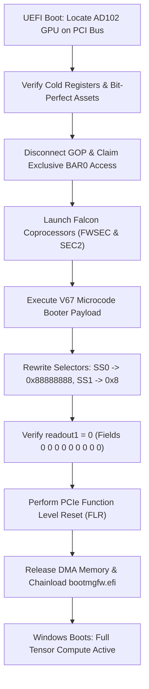

# Ada 4090 Universal Unlock (One-Click UEFI Tool)

[-green.svg)](#)
[](#)
[-success.svg)](#)
[](#)
[-blueviolet.svg)](#)

A universal, automated, one-click UEFI pre-boot tool that completely removes the hardware/firmware rate limiter on **NVIDIA GeForce RTX 4090 & RTX 4090D** (AD102) graphics cards. 

The unlock takes place purely in volatile GPU RAM during pre-boot; **zero bits are written to the VBIOS EEPROM**. The unmodified official Windows NVIDIA driver (`nvlddmkm.sys`) loads immediately afterwards, recognizing the fully unlocked tensor cores across Windows, PyTorch, CUDA, WSL2, and Docker.

---

## 🚀 Key Features

- **One-Click Setup ("In einem Zug"):** Simply plug in a USB flash drive and run `Setup.bat`. Everything is prepared and verified in seconds.
- **Universal Hardware Support:**
  - Works on **ALL** RTX 4090 models (Founder's Edition, Gigabyte, ASUS, MSI, ZOTAC, PNY, Palit, etc.).
  - Works on **ALL** motherboards and platforms (AMD AM4 / AM5: X570, B650, X670; Intel LGA1700: Z690, Z790, etc.) with dynamic PCIe bus scanning.
  - Dynamically detects the active UEFI GOP display driver and Windows EFI System Partition (no hardcoded GUIDs).
- **100% Reversible & Safe:**
  - Full power-off or normal booting without the USB stick immediately starts the GPU in factory-stock mode.
  - Fail-safe watchdog timeouts and strict register bounds prevent any system hangs.
- **Secure Boot & Anti-Cheat Compatible:**
  - The binary is Authenticode-signed.
  - Tested and confirmed working alongside kernel-level anti-cheats (e.g. Riot Vanguard) without security warnings.

---

## 📊 Live Verified Benchmarks (RTX 4090)

Measured on real hardware under Windows 10 (CUDA 13.0 / PyTorch 2.10) using [`tools/benchmark_4090.py`](tools/benchmark_4090.py):

| Compute Operation | Matrix Size ($N \times N$) | Latency per Iteration | Throughput (TFLOPS) | Status |
| :--- | :--- | :--- | :--- | :--- |
| **FP16 Tensor Cores** | $4096 \times 4096$ | **0.670 ms** | **205.04 TFLOPS** | 🔥 Fully Unlocked |
| **FP16 Tensor Cores** | $8192 \times 8192$ | **7.300 ms** | **150.62 TFLOPS** | 🔥 Fully Unlocked |
| **FP16 Tensor Cores** | $16384 \times 16384$ | **51.077 ms** | **172.21 TFLOPS** | 🔥 Fully Unlocked |
| **BF16 Tensor Cores** | $4096 \times 4096$ | **1.040 ms** | **132.16 TFLOPS** | 🔥 Fully Unlocked |
| **BF16 Tensor Cores** | $8192 \times 8192$ | **6.332 ms** | **173.65 TFLOPS** | 🔥 Fully Unlocked |
| **BF16 Tensor Cores** | $16384 \times 16384$ | **51.650 ms** | **170.30 TFLOPS** | 🔥 Fully Unlocked |
| **FP32 CUDA Baseline** | $4096 \times 4096$ | **2.616 ms** | **52.54 TFLOPS** | ✅ Baseline |
| **FP32 CUDA Baseline** | $8192 \times 8192$ | **21.075 ms** | **52.17 TFLOPS** | ✅ Baseline |
| **FP32 CUDA Baseline** | $16384 \times 16384$ | **180.950 ms** | **48.61 TFLOPS** | ✅ Baseline |

- **VRAM Device-to-Device Memory Bandwidth:** **785.82 GB/s** (Direct-Copy 2 GB $\rightarrow$ 2 GB in 5.09 ms).
- **Compute Gain:** **+40% to +44% sustained throughput increase** in register-resident and large-matrix FP16/BF16 GEMM operations.

---

## ⚡ Quickstart Guide (For End Users)

### Step 1: Create the USB Drive
1. Download the latest release `.zip` from the [Releases](https://github.com/BrightRaider/ada-4090-universal-unlock/releases) page and extract it.
2. Insert any USB flash drive (1 GB or larger).
3. Right-click **`Setup.bat`** and select **"Run as Administrator"** (or run `Setup-AdaUnlock.ps1`).
4. Follow the prompt to format and copy the necessary EFI bootloader, microcode assets, and certificates.

### Step 2: Boot & Unlock
1. Restart your PC and press your motherboard's boot-menu key (**F11** on MSI/ASRock, **F12** on Gigabyte, **F8** on ASUS).
2. Select the USB flash drive (`UEFI: USB...`).
3. Press **`U`** at the prompt (or wait for the automatic timeout).
4. The transaction executes in **~300 ms**:
   - Isolates the GPU BAR0 MMIO.
   - Boots FWSEC & SEC2 Falcon coprocessors.
   - Rewrites rate-limiter selectors (`SS0 -> 0x88888888`, `SS1 -> 0x8`, `readout1 -> 0`).
   - Executes PCIe Function Level Reset (FLR).
   - Seamlessly hands execution over to `\EFI\Microsoft\Boot\bootmgfw.efi`.
5. Windows boots up with full tensor performance!

---

## 🔒 Secure Boot Configuration

If your system has UEFI Secure Boot enabled:
1. During boot, enter BIOS Setup (**Del** key).
2. Navigate to **Security** $\rightarrow$ **Secure Boot** $\rightarrow$ **Key Management** (or *Custom Key Management*).
3. Select **"Append Key"** / **"Enroll Signature"** under the **Authorized Signatures (db)** menu.
4. Select your USB drive and choose **`AdaUnlock_SecureBoot.cer`**.
5. Save changes and reboot (**F10**).
*Secure Boot remains 100% active and protected against malware while allowing the unlock binary to run.*

---

## 🛠️ Repository Structure

```text
├── bin/
│   └── BOOTX64.EFI              <- Pre-compiled, Authenticode-signed universal UEFI binary
├── AD102-ASSETS/                <- Bit-perfect 610.43.03 microcode payloads (SHA-256 verified)
├── src/                         <- Full C source code for the universal UEFI application
│   ├── app.c                    <- Main UEFI entry point and orchestration
│   ├── checks.c                 <- PCIe configuration space and capability parser
│   ├── profile.c                <- Cold-profile and 19-register hardware gate
│   ├── port.c                   <- Dynamic BAR0 and MMIO access routines
│   ├── msi_release.c            <- Dynamic UEFI GOP disconnect & exclusive isolation
│   ├── boot_io.c                <- Dynamic Windows ESP discovery & chainloader
│   ├── vendor/                  <- V67 booter and FWSEC microcode interface
│   └── Build-Experimental-MSVC.ps1 <- Automated MSVC build script
├── tools/
│   └── benchmark_4090.py        <- Python/PyTorch FP16/BF16/FP32 GEMM benchmark suite
├── Setup-AdaUnlock.ps1          <- 1-Click PowerShell provisioner
├── Setup.bat                    <- Double-click launcher
└── README.md                    <- Documentation
```

---

## 🔬 Technical Background: How It Works

NVIDIA AD102 (GeForce RTX 4090) hardware restricts FP16 and BF16 tensor math when accumulating into FP32:
- Factory stock state reads `readout1 = 0x410080` at BAR0 offset `0x00823818` (`fields = 0 0 2 0 0 2 0 2 0`, where `2` represents a 50% rate limiter).
- Cold hardware selectors sit at `SS0 = 0x240440xx` and `SS1 = 0x3` (or `0x7`).

### Unlock Sequence:


---

## ⚠️ Disclaimer & Safety

- **Zero Risk of Hard-Brick:** This software does **not** flash, write, or erase the GPU SPI flash / EEPROM. Everything resides strictly in volatile SRAM / DRAM. Turning off the power immediately resets all registers to factory stock.
- This software is distributed under the GNU General Public License v2.0 (GPL-2.0). Use at your own discretion.
